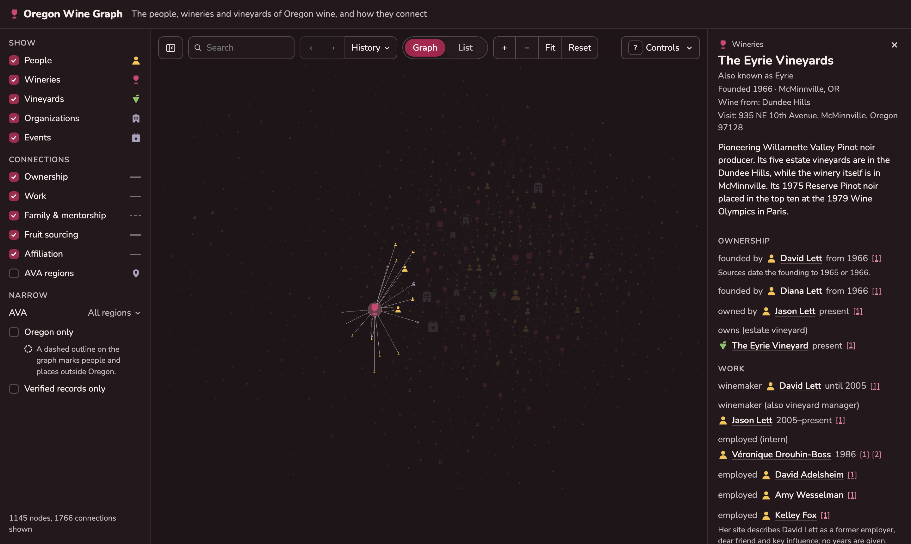

# Oregon Wine Graph

An explorable map of the people, wineries and vineyards behind Oregon wine, and how they connect: who founded what, who made the wine where, who trained whom, which vineyards supply which wineries, and how families and careers run through the industry from the 1960s pioneers to today.



## What you can explore

- **The graph.** Every person, winery, vineyard, AVA, organization and event is a node; every relationship between them is a line. Better-connected nodes are drawn larger, and the graph is arranged as islands of closely linked people and places, each named by its best-connected record. It opens on the best-connected records; "Show all records" in Filters adds the rest. Select one to zoom to it and everything it connects to, and to see its story, its connections and the sources for each.
- **Search and filters.** Find anyone by name, show or hide kinds of people and places or kinds of relationship, narrow to particular AVAs, or show only records that have been verified.
- **AVA regions.** Switch on "AVA regions" to see vineyards grouped inside the American Viticultural Areas they sit in.
- **List view.** The same people and places as a searchable list, readable by keyboard and screen reader.
- **Oral histories.** Hundreds of people and places link to their interview in Linfield University's Oregon Wine History Archive, with video and transcript.
- **Nearby tasting rooms.** Wineries with a known visitor address list the tasting rooms within 10 km.
- **Controls guide.** Press <kbd>?</kbd> for the controls on your device, mouse, trackpad or touch.
- **More room.** Hide the filters sidebar with the sidebar button at the left of the toolbar; the app remembers your choice.

Links share a selection: `/#the-eyrie-vineyards` opens straight to The Eyrie Vineyards.

## What's in it

As of 20 October 2026:

| | Records |
|---|---|
| People | 629 |
| Wineries | 592 |
| Vineyards | 147 |
| Organizations | 49 |
| AVAs | 20 |
| Events | 12 |
| **Connections** | **4,105** |

Of these 5,554 records, **4,373 (79%) are verified** against their sources, as described below. 729 people and places link to oral history interviews.

Coverage is strongest for the northern Willamette Valley, where Oregon's modern wine industry began and where most published history concentrates. Southern Oregon, the Columbia Gorge and Walla Walla are thinner. Interview summaries have been read; full interview transcripts have not yet, so some careers are less detailed than the record allows.

## How we know: the evidence behind each record

Every node and every connection in the graph cites at least one source, and each connection carries its own citations, so "David Lett founded The Eyrie Vineyards in 1966" points to the pages that say so. Select any record to see them.

### Verification

A record is either **verified** or an **unverified draft**. Drafts are shown, because a cited but unchecked fact is still useful, but "Verified records only" hides them. A record becomes verified in one of three ways:

1. **Reviewed by a person.** Someone has read the cited sources and confirmed the record.
2. **Checked against its sources automatically.** A decision model reads the text of each cited page and judges whether it supports the record: the relationship itself, each year, and the role; for a person or place, each sentence of its summary. A record is approved only when a source supports its central claim, and every detail is supported, each with a confidence of at least 0.9. A detail may rest on facts spread across several of the record's sources, which the model then reads together; a record is never shown as verified by that combined reading alone. For a connection, the model must also find that the source states this relationship rather than only a different one between the same two, so a page saying someone founded a winery doesn't pass for their working there. To measure how often this goes wrong, we deliberately corrupted one fact in each of 400 records that had passed (a year changed, a sentence, party or relationship swapped for one that is false) and checked them again: 1.0% still passed at 0.9. Sources the model can't read directly, such as pages behind bot protection, are read from the Internet Archive's copy where there is one, and otherwise never count for or against a record. For a federal label approval, the model also looks at the label images, since a label usually names its vineyard only in the artwork. Reading images is an early-stage feature of the model: in a test on deliberately wrong label claims, including another vineyard the same winery buys from, none passed, but the sample was small, so a record supported only by label images says so in its verification note, beside its sources.
3. **Confirmed by AVA boundaries.** A vineyard's AVA can be confirmed by testing its location against the official AVA boundary maps. This is available but not yet in use, as no vineyard has mapped coordinates yet.

Today 4,185 records are verified by the automated check and 188 by a person; the remaining 1,181 are drafts. The site's "Verified records only" filter has an ⓘ that shows the current counts.

### Rules we follow

- **Nothing is guessed.** If no source gives a year, the record has no year. Hedged statements ("I think", "reportedly") don't become records.
- **Where sources disagree, the record says so.** For example, The Eyrie Vineyards' founding is dated 1965 by some sources and 1966 by others, so its record reads "1965 or 1966", with an ⓘ beside it. We show every year a source gives rather than choosing one.
- **Corrections are logged.** When research finds a source showing a record was wrong, the correction is made only if the check then supports the corrected record, and each one is listed, with the old and new value and the source, in [tools/verify/corrections.json](tools/verify/corrections.json).
- **Addresses are for visitors.** A winery's address is where you can taste, often a tasting room some distance from its vines. It is never used as evidence of where grapes are grown; vineyards and the AVAs a winery draws fruit from are recorded separately.
- **Private sources contribute facts, not text.** Some records come from a subscriber newsletter; only the facts are kept, never its wording.
- **A label approval is evidence of a plan, not a sale.** A winery files a federal label approval before bottling, and some approved wines are never released. A connection resting only on approvals says so in its verification note, beside its sources.
- **Summaries are our own words.**

### Sources

The main sources, by how many records cite them:

- [Oregon Wine History Archive](https://oregonwinehistoryarchive.org), Linfield University: oral history interviews and their summaries
- Weinnotes, a monthly Oregon wine newsletter
- [The Prince of Pinot](https://www.princeofpinot.com)
- [Wikipedia](https://en.wikipedia.org)
- [Oregon Wine Press](https://www.oregonwinepress.com)
- [Wine Spectator](https://www.winespectator.com) and [Great Northwest Wine](https://www.greatnorthwestwine.com)
- Wineries' own websites, for their founders, winemakers and vineyards
- [TTB Public COLA Registry](https://ttbonline.gov/colasonline/publicSearchColasBasic.do) (public domain): federal label approvals, for the vineyards a winery's wines are named for and the AVAs on its labels. Each citation links to the approval.
- [WineEnthusiast reviews, June 2017](https://www.openml.org/d/42074) (OpenML dataset 42074, CC BY-NC-SA 4.0): only each Oregon review's winery, wine name, region and variety, never the reviewers' writing, scores or prices
- [UC Davis Library AVA boundaries](https://github.com/UCDavisLibrary/ava) (public domain), for AVA geography

## Corrections and contributions

Found something wrong or missing? [Open an issue](https://github.com/arringtonm/oregon-wine-graph/issues) with the record and, ideally, a source. The most useful sources are published and specific: an interview, a winery's own history page, a news story or book naming the people and the years. Corrections that come with a source are checked and applied like any other record.

You can also flag a fact from its record card. Each morning new flags are checked again against the record's sources and any source you suggested. A suggested source that supports the record is added. A correction is made only when the check supports it, and is logged with the others. Everything else goes to a person.

## Running it yourself

```sh
npm install
npm run dev
```

Then open the address it prints. The [developer guide](docs/DEVELOPMENT.md) covers the data format, the review tools, the automated source check and the research tools.

## Credits

Data from the sources above, with particular thanks to Linfield University's Oregon Wine History Archive. Built with [Vue](https://vuejs.org), [Cytoscape.js](https://js.cytoscape.org), [Reka UI](https://reka-ui.com) and [Zod](https://zod.dev); set in [Nunito](https://fonts.google.com/specimen/Nunito) (SIL Open Font License). Automated source checks use [Jev](https://typesafe.ai) from TypeSafe AI.
